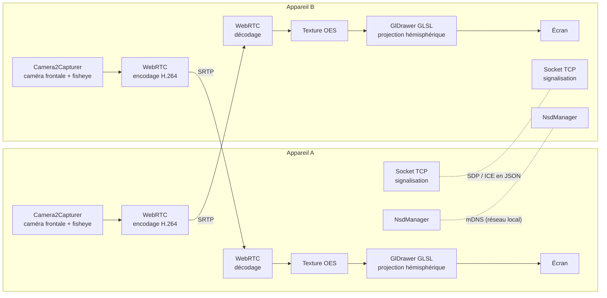

# Projet libre - TeleDiorama 180

## Équipe

- **Noah Hilaire**
- **Célian Hache**

## Description du projet

**TeleDiorama 180** est une application Android open-source de téléprésence : deux téléphones, placés chacun dans un petit boîtier (le « diorama »), forment une fenêtre bidirectionnelle entre deux lieux. Chaque appareil filme son environnement avec une lentille fisheye d'environ 180° et envoie le flux en temps réel à l'autre appareil, qui le corrige en le projetant sur une demi-sphère 3D. Le téléphone reste fixe dans son boîtier : c'est le cadre en carton qui limite le champ de vision et crée l'illusion de regarder par une fenêtre ouverte sur l'autre lieu.

Le projet se limite à l'application : aucun serveur n'est développé ni hébergé. Les deux appareils communiquent directement, soit sur le même réseau local, soit à travers un VPN qui les place dans un même réseau virtuel (Tailscale ou WireGuard, par exemple). Le VPN permet de relier deux lieux éloignés.

## Dispositif

### Matériel

- 2 appareils Android.
- 2 lentilles fisheye (180°) montées sur la caméra frontale de chaque appareil, du même côté que l'écran : la caméra filme la pièce dans laquelle se trouve l'observateur, et l'écran montre la pièce distante.
- 2 boîtiers diorama (carton) maintenant l'appareil à la verticale et encadrant l'écran comme une fenêtre.

### Configuration physique

```
   Lieu A                                   Lieu B
┌──────────────┐                            ┌──────────────┐
│  Diorama A   │                            │  Diorama B   │
│ ┌──────────┐ │       flux vidéo 180° →    │ ┌──────────┐ │
│ │  écran   │ │      ← flux vidéo 180°     │ │  écran   │ │
│ │ (vue B)  │ │                            │ │ (vue A)  │ │
│ └──────────┘ │                            │ └──────────┘ │
│   fisheye    │                            │   fisheye    │
└──────────────┘                            └──────────────┘
      ↑ observateur A                               ↑ observateur B
      └────────── même réseau local ou VPN ─────────┘
```

   Le téléphone est statique. La vue projetée est fixe, son cadrage est réglé une fois à l'installation, et le cadre en carton masque les bords de l'écran pour ne laisser voir qu'une ouverture sur la pièce distante.

## Connexion entre les appareils

### Découverte

- **Réseau local** : chaque application annonce un service DNS-SD (par exemple `_telediorama._tcp`) avec `NsdManager` (mDNS) et liste les appareils trouvés. L'utilisateur choisit l'appareil auquel se connecter.
- **VPN** : les VPN comme Tailscale ou WireGuard ne transmettent pas le multicast, donc mDNS n'y fonctionne pas. L'utilisateur saisit l'adresse IP ou le nom d'hôte VPN de l'autre appareil (par exemple un nom MagicDNS Tailscale). L'application mémorise les appareils déjà connectés.

### Signalisation sans serveur

WebRTC a besoin d'échanger une offre/réponse SDP et des candidats ICE avant d'établir le flux. Au lieu d'un serveur de signalisation, chaque application ouvre un socket TCP sur un port fixe. L'appareil qui initie la connexion s'y connecte directement et les deux applications échangent ces messages en JSON. Ce socket ne sert qu'à établir la session, la vidéo passe ensuite directement entre les deux pairs.

## Objectifs et critères de réussite

### MVP (requis pour la démonstration)

- Découverte automatique et connexion entre deux appareils sur le même réseau local.
- Connexion par adresse IP à travers un VPN.
- Flux vidéo bidirectionnel.
- Correction de la distorsion fisheye par projection hémisphérique.
- Vue fixe cadrée dans le boîtier diorama.

### Critères mesurables

| Critère | Cible |
| :--- | :--- |
| Latence de bout en bout (capture → affichage), réseau local | < 300 ms |
| Résolution / fréquence d'images | 960×720 à 30 FPS stables (format 4:3, voir Faisabilité) |

## Technologies

- **Kotlin et Android Studio** : langage et environnement de développement.
  - [Documentation Android Developers](https://developer.android.com/develop?hl=fr)
- **WebRTC (bibliothèque Android précompilée `io.github.webrtc-sdk:android`)** : capture caméra (`Camera2Capturer`), encodage, transport pair-à-pair (ICE, DTLS, SRTP) et décodage du flux vidéo. Google ne publie plus de version Android officielle, on utilise donc cette version communautaire. Codecs visés : H.264 matériel, ou VP8 si l'encodeur matériel est indisponible.
  - [Documentation WebRTC](https://webrtc.org)
- **Network Service Discovery (`NsdManager`)** : annonce et découverte des appareils sur le réseau local.
  - [Documentation NSD](https://developer.android.com/develop/connectivity/wifi/use-nsd?hl=fr)
- **OpenGL ES (shaders GLSL)** : projection de la texture vidéo (texture externe OES fournie par WebRTC) sur une demi-sphère pour corriger la distorsion fisheye. Le shader s'intègre via un `GlDrawer` personnalisé de WebRTC, ce qui évite de gérer un contexte GL séparé. Filament reste une solution de repli.
  - [Documentation OpenGL ES sur Android](https://developer.android.com/develop/ui/views/graphics/opengl?hl=fr)
- **Jetpack Compose** : interface utilisateur (liste des appareils, saisie d'adresse, réglages, informations de débogage). La vue vidéo est intégrée via `AndroidView`.
  - [Documentation Jetpack Compose](https://developer.android.com/develop/ui/compose/documentation?hl=fr)

## Architecture



## Faisabilité

| Point | Évaluation | Remarque |
| :--- | :--- | :--- |
| WebRTC sans serveur | Faisable | La signalisation n'est qu'un échange de messages ; un socket TCP direct entre les deux applications suffit. ICE fonctionne avec les seuls candidats hôtes quand les appareils se voient directement. |
| Découverte en réseau local | Faisable | `NsdManager` est intégré à Android. Certains appareils nécessitent un `MulticastLock` pour recevoir les annonces mDNS. |
| Découverte via VPN | Faisable avec saisie manuelle | Tailscale et WireGuard ne transmettent pas le multicast : la découverte automatique ne fonctionne pas, d'où la saisie de l'adresse. |
| Format du cercle fisheye | Contrainte de conception | Le cercle fisheye occupe la hauteur du capteur (4:3). Une capture en 16:9 (1280×720) couperait le haut et le bas du cercle, il faut donc capturer en 4:3. |
| Correction fisheye | Faisable | Le modèle équidistant se code en quelques lignes de GLSL. La principale difficulté est l'étalonnage (centre optique, rayon du cercle). |
| Rendu de la texture WebRTC | Faisable | WebRTC fournit les images sous forme de texture OES ; un `GlDrawer` personnalisé y applique directement le shader. |
| Lentille sur la caméra frontale | Risque matériel | Les caméras frontales en « poinçon » dans l'écran sont parfois difficiles à aligner avec une lentille à clipser. À tester dès réception du matériel. |
| Latence < 300 ms en réseau local | Réaliste | Sur un réseau local, WebRTC atteint en général 100 à 200 ms. Sur VPN, la latence dépend du trajet réseau. |

## Git

Le code et la documentation du projet sont sur le dépôt public :

- [Dépôt GitHub](https://github.com/CelianHache/mobile-portal)

## Plan de travail

### Tâches et jalons

| Échéance | Tâche | Livrable | Responsable(s) |
| :--- | :--- | :--- | :--- |
| **Séance 5** | Lancement du projet | Idée validée, rôles répartis, dépôt GitHub initialisé. | Noah & Célian |
| **Séance 7** | Proposition écrite | Document de proposition remis. Matériel choisi et lentilles commandées. Étape obligatoire. | Noah & Célian |
| **Séance 8** | Sprint 1 : Connexion | Découverte NSD, signalisation par socket TCP, flux vidéo WebRTC brut entre deux appareils sur le même réseau local. Test rapide sur VPN. | Noah |
| **Séance 8** | Sprint 1 : Rendu | `GlDrawer` projetant une image fisheye statique sur une demi-sphère, avec un cadrage fixe. | Célian |
| **Séance 9** | Jalon d'intégration | Le flux WebRTC brut passe dans le `GlDrawer` de projection (sans correction fine). Première version de bout en bout. | Noah & Célian |
| **Séance 11** | Sprint 2 : Réseau | Flux bidirectionnel, connexion par adresse IP via VPN, mémorisation des appareils, réglage résolution/débit/codec. | Noah |
| **Séance 11** | Sprint 2 : Correction optique | Étalonnage de la lentille (centre optique, rayon du cercle, champ de vision réel), shader de correction final, réglage du cadrage dans le boîtier. | Célian |
| **Séance 12** | Sprint 3 : Finalisation | Boîtiers diorama, mesures des critères (latence, FPS), correction des bugs, README à jour. | Noah & Célian |
| **Séance 12** | Gel des fonctionnalités | Version de démonstration figée, répétition de la démo en réseau local et via VPN, diapositives préparées. | Noah & Célian |
| **Séance 13** | Démonstration | Démonstration de l'application et revue du code sur GitHub. 50 % de la note finale. | Noah & Célian |
| **Séance 14** | Présentation orale | Soutenance de 15 minutes avec diapositives (démarche, résultats mesurés, limites). 50 % de la note finale. | Noah & Célian |

Le suivi entre les jalons se fait par des commits réguliers et des issues GitHub.

### Risques identifiés et solutions de repli

1. **Isolation des clients sur le Wi-Fi** (réseaux universitaires ou publics qui empêchent deux appareils de se voir et bloquent le multicast).
   - *Repli :* point d'accès créé par un des deux téléphones (ou un routeur de voyage) pour la démonstration ; à défaut, connexion via VPN.
2. **Latence élevée ou saccades du flux vidéo.**
   - *Repli :* réduire la résolution (960×720 → 640×480), limiter à 30 FPS, forcer l'encodeur matériel H.264 (ou VP8 s'il est indisponible), plafonner le débit.
3. **Surchauffe et consommation de batterie** (capture + encodage + rendu GL en continu).
   - *Repli :* alimentation secteur dans le boîtier, baisse automatique de la résolution quand la température monte, rendu limité à 30 FPS.
5. **WebRTC ne collecte pas de candidat sur l'interface VPN.**
   - *Repli :* ajuster les options réseau de WebRTC (types d'interfaces ignorées) ; en dernier recours, remplacer WebRTC par un flux H.264 envoyé directement en UDP (`MediaCodec`), plus simple mais sans gestion des pertes.